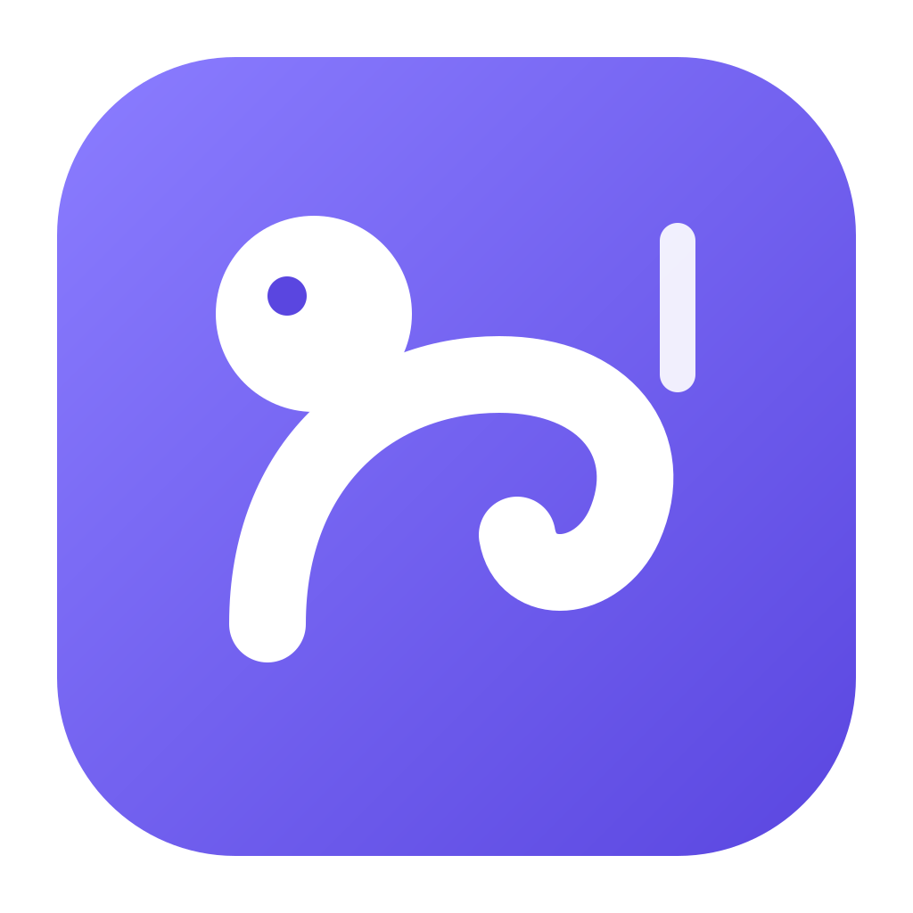
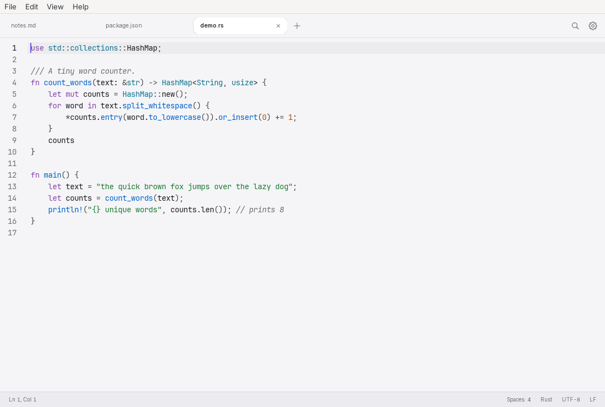

<div align="center">



# Nimble Newt

**A fast, modern text editor for Windows and macOS.**
Notepad++ simplicity, a clean Apple-inspired design, and a small native app built with Rust and Tauri.

[](https://github.com/Ferdinand99/Nimble-Newt/actions/workflows/ci.yml)
[](LICENSE)
[](https://hedgerow.tools/Nimble-Newt/)

<picture>
  <source media="(prefers-color-scheme: dark)" srcset="docs/screenshots/editor-dark.png">
  <source media="(prefers-color-scheme: light)" srcset="docs/screenshots/editor-light.png">
  
</picture>

</div>

> The screenshots are taken from a real Linux build (Xvfb), which is why a native menu bar sits above the tabs.
> **TODO:** replace them with screenshots from the Windows and macOS builds (macOS uses an overlay title bar with the traffic lights in the tab bar).

## Contents

- [Features](#features) · [Download](#download) · [Updates](#updates) · [Shortcuts](#keyboard-shortcuts)
- [Build from source](#build-from-source) · [Architecture](#architecture) · [Performance](#performance)
- [Translating](#translating) · [Roadmap](#roadmap) · [License](#license)

## Features

- **Tabs and sessions.** Many tabs, drag to reorder, close / close others / close to the right. **Unsaved tabs (including "Untitled") survive quitting and restarting**, like Notepad++: their content lives in the app's data folder, never next to your files. Cursor position and scroll are restored too. Switch it off in Settings.
- **Open and save.** Open from the menu, by drag and drop, with "Open with…" or as the default app for common file types. Modified marker on tabs, atomic saves (a crash never truncates your file), and a prompt to reload when a file changes on disk.
- **Encodings and line endings.** Detects UTF-8 (with/without BOM), UTF-16 LE/BE and about 35 legacy code pages (Windows-125x, ISO-8859, Shift-JIS, GBK, Big5, EUC-KR, KOI8…). Shown in the status bar; click to convert, or to reopen the file with another encoding. LF / CRLF / CR likewise. Characters that the target encoding cannot represent are reported, never silently lost.
- **Syntax highlighting** for 96 languages, loaded on demand: chosen from the file name, shebang or (for untitled tabs) the content, and switchable from the status bar. Define **your own languages** (keywords, comments, strings) in Settings.
- **Search and replace.** In-file find/replace with regex, case and whole-word options and live match counts. **Find in Files**: regex, glob filters, `.gitignore` aware, binary files skipped, clickable results, and a **Replace All preview** with per-file opt-out before anything is written.
- **Editing.** Multiple cursors (Ctrl/Cmd+click, Ctrl/Cmd+D, Ctrl/Cmd+Alt+Up/Down), column selection (Alt+drag or Alt+Shift+arrows) and **column editing** with number sequences, duplicate / move / delete / join / sort / dedupe lines, toggle comments, auto-indent, bracket matching and closing, code folding, visible whitespace, word wrap, zoom, and **word completion** from the document.
- **Macros.** Record (Ctrl/Cmd+Alt+R), play (Ctrl/Cmd+Alt+P), repeat several times or to the end of the file, and save named macros.
- **Bookmarks and highlights.** Bookmarks in the gutter (Ctrl/Cmd+F2, F2 / Shift+F2) that survive a restart, and five highlight colours for occurrences.
- **Compare.** Compare two tabs or files side by side with live editing and apply-change buttons (F7 / Shift+F7 to step); very large comparisons use a Rust diff and a hunk list.
- **Split view and document map.** Two views of the same file with independent scrolling, an optional minimap, and a **function list / outline** panel (Ctrl/Cmd+Shift+O).
- **Folder as workspace.** Open a folder to get a file tree and a filename filter (Ctrl/Cmd+Shift+E).
- **Very large files.** Files above 256 MB open instantly in a read-only viewer that indexes in the background, with search, go to line and **follow** (tail) for growing logs. Smaller files are fully editable.
- **Tools.** Format and minify JSON / XML, Base64 / URL / HTML / hex encoding, MD5 / SHA checksums for text or files, timestamp conversion and UUIDs, from a tools panel.
- **Extensions.** Small sandboxed add-ons that contribute commands and text tools, with explicit permissions and no file or network access ([docs/extensions.md](docs/extensions.md)). Three are built in: Word Count, Markdown Helpers and Text Cleaner.
- **Command palette** (Ctrl/Cmd+Shift+P) with every action, and **quick open** for recent files.
- **Settings.** Theme (system / light / dark), interface language (26, chosen automatically from the system or set by hand), font size, tabs or spaces, default encoding and line ending, word wrap, whitespace, session restore, automatic updates.
- **Status bar.** Line/column, selection, indentation, language, encoding and line endings; everything is clickable.
- **Automatic updates** from GitHub Releases, with signature verification (see [Updates](#updates)).
- **Accessible by default.** Keyboard navigation everywhere, visible focus, `prefers-reduced-motion`, `prefers-contrast` and `prefers-reduced-transparency` respected, syntax colours that meet WCAG AA contrast.

## Download

Get the latest installer from the [Releases page](https://github.com/Ferdinand99/Nimble-Newt/releases/latest):

| Platform | File |
|---|---|
| Windows 10/11 (x64) | `.exe` (NSIS) or `.msi` |
| macOS 11+ (Apple Silicon and Intel) | `.dmg` (universal) |

The macOS build is signed and notarized. The Windows build is not code-signed yet ([docs/signing.md](docs/signing.md)), so SmartScreen warns on first launch: click **More info → Run anyway**.

## Updates

Nimble Newt **updates itself**. At start and then every 6 hours it checks
`https://github.com/Ferdinand99/Nimble-Newt/releases/latest/download/latest.json`. When a newer version exists, a small **Update x.y.z** pill appears in the status bar; click it to read the release notes, **Download and Install** with a progress bar, then **Restart to Update**. Your tabs, including unsaved ones, come back after the restart.

- **Check for Updates…** is in the app menu (macOS) or Help menu (Windows); the automatic check can be turned off in Settings → Updates.
- Every update is verified against the public key built into the app; a download with a wrong or missing signature is never installed, and you get a clear message (offline, invalid signature, unreadable manifest).
- Setting up the signing key and the GitHub secrets is a one-time owner task: see [docs/updates.md](docs/updates.md).

## Keyboard shortcuts

On macOS `Ctrl` is `⌘` (Command). Editor-level keys (multi-cursor, line operations) work in the editor itself; everything is also in the command palette.

| Action | Windows | macOS |
|---|---|---|
| New Tab | `Ctrl+N` | `⌘N` |
| Open File… | `Ctrl+O` | `⌘O` |
| Open Recent File… | `Ctrl+P` | `⌘P` |
| Save | `Ctrl+S` | `⌘S` |
| Save As… | `Ctrl+Shift+S` | `⌘⇧S` |
| Save All | `Ctrl+Alt+S` | `⌘⌥S` |
| Close Tab | `Ctrl+W` | `⌘W` |
| Reopen Closed Tab | `Ctrl+Shift+T` | `⌘⇧T` |
| Undo | `Ctrl+Z` | `⌘Z` |
| Redo | `Ctrl+Y` | `⌘⇧Z` |
| Select All | `Ctrl+A` | `⌘A` |
| Find… | `Ctrl+F` | `⌘F` |
| Replace… | `Ctrl+H` | `⌥⌘F` |
| Find Next | `F3` | `F3` |
| Find Previous | `Shift+F3` | `⇧F3` |
| Find in Files… | `Ctrl+Shift+F` | `⌘⇧F` |
| Go to Line… | `Ctrl+G` | `⌘L` |
| Duplicate Line | `Ctrl+Shift+D` | `⌘⇧D` |
| Delete Line | `Ctrl+Shift+K` | `⌘⇧K` |
| Move Line Up | `Alt+↑` | `⌥↑` |
| Move Line Down | `Alt+↓` | `⌥↓` |
| Toggle Line Comment | `Ctrl+/` | `⌘/` |
| Toggle Block Comment | `Ctrl+Shift+A` | `⌘⇧A` |
| Select Next Occurrence | `Ctrl+D` | `⌘D` |
| Add Cursor Above | `Ctrl+Alt+↑` | `⌘⌥↑` |
| Add Cursor Below | `Ctrl+Alt+↓` | `⌘⌥↓` |
| Command Palette… | `Ctrl+Shift+P` | `⌘⇧P` |
| Toggle Word Wrap | `Alt+Z` | `⌥Z` |
| Zoom In | `Ctrl+=` | `⌘=` |
| Zoom Out | `Ctrl+-` | `⌘-` |
| Reset Zoom | `Ctrl+0` | `⌘0` |
| Next Tab | `Ctrl+Tab` | `⌃Tab` |
| Previous Tab | `Ctrl+Shift+Tab` | `⌃⇧Tab` |
| Settings… | `Ctrl+,` | `⌘,` |
| Add cursor | `Ctrl+Click` | `⌘Click` |
| Column selection | `Alt+Drag`, `Alt+Shift+Arrows` | `⌥Drag`, `⌥⇧Arrows` |

## Build from source

Requirements: [Rust](https://rustup.rs) (stable), Node.js 22+, and the [Tauri prerequisites](https://v2.tauri.app/start/prerequisites/) for your OS (WebView2 on Windows, Xcode command line tools on macOS; on Linux `libwebkit2gtk-4.1-dev` and friends).

```sh
npm ci
npm run tauri dev            # run with hot reload
npm run build:unsigned       # installers in target/release/bundle/ (no updater key needed)
```

`npm run tauri build` also produces the signed updater artifacts and therefore needs `TAURI_SIGNING_PRIVATE_KEY` (see [docs/updates.md](docs/updates.md)); `build:unsigned` switches those off for local builds.

Checks used by CI:

```sh
cargo fmt --all -- --check && cargo clippy --workspace --all-targets -- -D warnings && cargo test --workspace
npm run typecheck && npm run lint && npm test
```

## Architecture

```
crates/core/    Rust library, no GUI: encoding detection/conversion (encoding_rs, chardetng), line endings,
                atomic file IO, session store, folder search/replace (ignore, regex, globset), update logic
src-tauri/      Tauri 2 shell: commands, native menu, file associations, single instance, updater plugin
src/            TypeScript frontend (Vite): CodeMirror 6 editor, UI, commands, locales
docs/           design system, update setup, code signing
```

**Why no UI framework?** The UI is a handful of long-lived pieces (tab bar, status bar, a few dialogs) around a single CodeMirror view that owns the hard part. Plain TypeScript with a small `h()` helper keeps the bundle small, startup fast and the code easy to follow; a framework would add weight without removing meaningful complexity. Languages are lazy-loaded, so a start only pays for the grammar of the file you are looking at.

**Design.** Colours, type, spacing, radii and motion come from the [Vigilant Vole](https://github.com/Ferdinand99/Vigilant-Vole) design system; see [docs/design-system.md](docs/design-system.md).

## Performance

Start-up is measured from the first line of `run()` to the first painted frame with content (`app_ready`), by the app itself: `NIMBLE_STARTUP_REPORT=<file> nimble-newt` writes `{"startup_ms", "frontend_ms", "stages"}` and exits. CI runs this five times per platform and prints min/median plus binary and installer sizes in the job summary of every build.

Honest numbers so far, from the Linux build in a headless sandbox with software rendering (Xvfb, WebKitGTK), release profile:

| Case | Start-up |
|---|---|
| Restoring a session / opening a file | ≈ 0.65–0.8 s |
| First ever launch (empty profile, WebKit creates its caches) | ≈ 2 s |
| Release binary (Linux, stripped, LTO) | 8.7 MB |

This is **not yet the < 300 ms target**: roughly 0.3 s is process and webview start, about 0.4 s is the page (script load, session restore, two painted frames) and the sandbox has no GPU. The window is shown as soon as the chrome is ready, before tabs are restored. Windows and macOS numbers come from the CI job summaries; see the latest [CI run](https://github.com/Ferdinand99/Nimble-Newt/actions/workflows/ci.yml).

## Translating

UI strings live in `src/locales/<code>.json`; English is the source and there are 25 translations (ar, cs, da, de, es, fa, fi, fr, he, hu, it, ja, ko, nb, nl, pl, pt-BR, pt-PT, ro, ru, sv, tr, uk, zh-CN, zh-TW). Arabic, Persian and Hebrew mirror the interface; code and file content stay left-to-right. Native menu labels use the same files (`menu.*` and `cmd.*` keys). The translations were machine-written and have not been reviewed by native speakers, so corrections are very welcome.

To fix or add a language: edit or copy `en.json`, translate the values (keep `{placeholders}`), add it to `LOCALES` in `src/lib/i18n.ts` and to the list in `src-tauri/src/menu.rs`. `npm test` fails unless every language has exactly the English keys and the same placeholders.

## Roadmap

Not done yet:

- Extension panels, access to other files and a catalogue for finding extensions
- Showing two different tabs in an editable split (a side-by-side compare view already works)
- Editing in the large-file viewer
- Windows code signing ([docs/signing.md](docs/signing.md))

## License

[MIT](LICENSE). The Inter typeface is included under the SIL Open Font License (`public/fonts/Inter-LICENSE.txt`); the design system and icons derive from [Vigilant Vole](https://github.com/Ferdinand99/Vigilant-Vole) (MIT).
